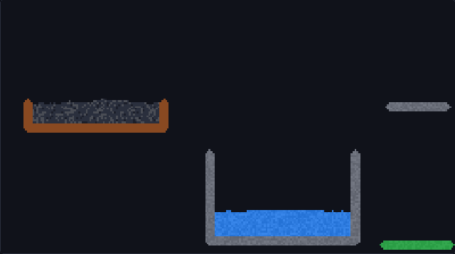

<div align="center">

# sabbia

**A falling-sand game. The physics is written in Rust and runs in your browser as WebAssembly.**

Pour sand, water, oil, lava and acid, light fires, grow plants, and watch the materials react.

### [▶ Play it in your browser](https://andreaacanfora.github.io/sabbia/)

[](https://github.com/AndreaAcanfora/sabbia/actions/workflows/ci.yml)
[](Cargo.toml)
[](src/wasm.rs)
[](LICENSE)
[](https://www.paypal.com/paypalme/AndreaAca)



</div>

## Materials

| | Material | Behaviour |
| --- | --- | --- |
| 🟨 | **Sand** | falls and piles up; sinks through water and oil; lava melts it into glass |
| 🟦 | **Water** | flows and levels out; puts fire out; turns to steam on lava |
| 🟧 | **Fire** | spreads to fuel and stays alive while it has some; leaves smoke |
| 🟫 | **Wood** | burns slowly, in place, as glowing embers that throw flames upward |
| ⬛ | **Oil** | floats on water and burns fast |
| 🟥 | **Lava** | thick and slow; ignites fuel, melts ice and sand, becomes stone in water |
| 🟩 | **Acid** | eats through almost everything except glass and walls, and is used up doing it |
| ⬜ | **Ice** | slowly freezes the water it touches; melts near fire and steam |
| 🌱 | **Plant** | grows by drinking water; burns |
| 🪨 | **Stone** | heavy rubble, from lava meeting water |
| 🧱 | **Wall** | indestructible |

Smoke, steam, embers and glass appear from reactions. Steam sometimes condenses back into water.

**Controls:** drag to draw (mouse or finger), keys `1`-`9` and `0` pick a material, `W` wall, `E` eraser, `[` `]`
brush size, `Space` pause, `C` clear. **🔗 Share** copies a link that recreates your scene for anyone who opens it.
It installs as an app on phones and works offline.

## How it works

The world is a grid of cells, and each step every cell follows a few local rules: sand tries to move down, then
diagonally down; liquids also flow sideways; gases rise; and cells react with their four neighbours. It is a
cellular automaton, like Conway's Game of Life with more interesting chemistry.

- **Rust does all the work.** [`src/world.rs`](src/world.rs) holds the rules and draws every cell into an RGBA pixel
  buffer. The browser's JavaScript only sends input and copies that buffer to a `<canvas>`.
- **No bindings generator, no imports.** The WebAssembly module exports a dozen plain functions
  ([`src/wasm.rs`](src/wasm.rs)): `init`, `step`, `paint`, `pixels`... `pixels()` returns a pointer, and JavaScript
  wraps WebAssembly memory in an `ImageData` directly, so a frame is drawn without copying between Rust and JS.
  CI checks that the module imports nothing.
- **No bias.** Cells are visited bottom to top, alternating left-to-right and right-to-left every step, and each
  cell moves at most once per step, so piles are symmetric and nothing drifts to one side.
- **Density.** Heavier materials displace lighter fluids: sand sinks through water, water sinks under oil, smoke
  only rises into empty space.
- **Deterministic.** Randomness comes from a seeded xorshift generator: the same seed and the same strokes give the
  same world, which makes the physics testable.
- **Steady speed.** The page runs the simulation at a fixed 60 steps per second, so it plays at the same speed on
  60 Hz and 120 Hz screens.
- **Small share links.** Scenes are run-length encoded in Rust ([`src/scene.rs`](src/scene.rs)) and then deflated
  with the browser's built-in `CompressionStream`, so a full drawing fits in a link of about a thousand characters.

### Performance

`cargo run --release --example bench` simulates a busy 480×270 world (130,000 cells: a fire, a lake, sand and lava
pouring, acid eating a wall). On the machine this was developed on, natively:

```text
480x270 (129600 cells): 2000 steps in 1.80s, 900µs per step, 1111 steps/s, 143.9 M cell updates/s
```

In Chromium, as WebAssembly, a 320×177 world takes **about 1 ms per step**: the physics uses less than a tenth of
each 16 ms frame. CI runs the benchmark on every change.

## Run it locally

```bash
rustup target add wasm32-unknown-unknown
scripts/build-web.sh               # builds web/sabbia.wasm (about 35 KB)
python3 -m http.server -d web      # then open http://localhost:8000
```

```bash
cargo test                         # physics tests: run on several random seeds each
cargo run --release --example bench
```

The tests describe the physics in plain terms: sand falls and mass is conserved, sand piles into a slope, water
levels out, oil floats, walls hold, fire burns wood away and dies without fuel, water puts fire out, lava and water
make stone and steam, acid eats a floor but not glass, gases rise and vanish, burning wood never leaves its plank,
scenes survive a round trip through a share link, and corrupt links are rejected. Probabilistic reactions are
checked with five seeds each, so a test cannot pass by luck.

## Ideas

- [ ] Gunpowder and explosions
- [ ] Temperature as a field (heat spreading through metal)
- [ ] Particles with velocity, so sand can splash
- [ ] A gallery of shared scenes
- [ ] Multithreaded simulation in chunks (WebAssembly threads)

## Support

sabbia is free and open source. If it made you lose ten minutes pouring lava on things, you can
[buy me a coffee on PayPal](https://www.paypal.com/paypalme/AndreaAca). Thank you!

## License

[MIT](LICENSE) © Andrea Acanfora
